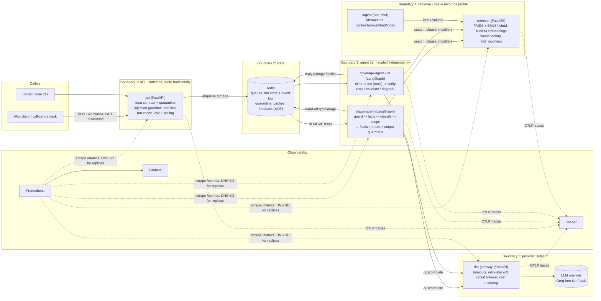
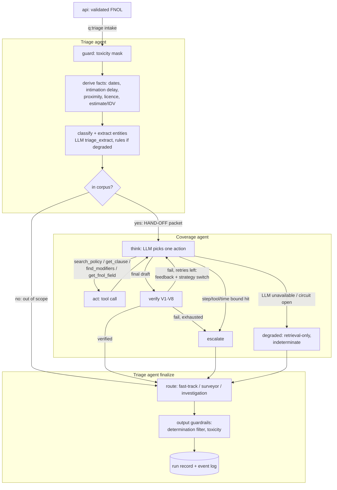

# Architecture

## Services and deployment boundaries

| Boundary | Container(s) | Why it is separate |
|---|---|---|
| API | `api` | **Independent release and failure isolation.** The ingestion boundary (contract, quarantine, guardrails, rate limit) must keep rejecting bad input and answering polls even while agents are saturated or down. It is stateless, so it scales on request rate rather than run rate. |
| State | `redis` | The queue decouples submission from execution (A4). It holds the run record and event log, so a run survives any agent crash. AOF persistence. |
| Agent tier | `triage-agent`, `coverage-agent` | **Scaling.** The coverage agent does most model and tool calls (about 4 of 5 per run), so it is the unit scaled with `--scale coverage-agent=N`. Triage is cheap. Separate queues give each agent its own failure domain and lease/retry semantics. The coverage agent can be redeployed (new prompt version, for example) without touching intake. |
| Retrieval | `retriever`, `ingest` | **Resource profile.** torch plus model weights take about 1 GB RAM and need CPU for embeddings. Every other image stays light (no torch). The index is rebuilt by a one-shot job, and `/admin/reembed` updates clauses in place without restarting agents. |
| Provider | `llm-gateway` | **Failure isolation and a single control point.** One circuit breaker per provider, not one per agent replica, so replicas cannot retry-storm a failing provider. Cost metering and provider choice live here, and switching provider is a config change to this one container. |
| Observability | `prometheus`, `grafana`, `jaeger` (+ optional `cadvisor`) | Standard. Each app container runs one process, so per-process CPU/RSS metrics are per-container resource metrics. cAdvisor is an optional profile for Docker-level stats. |

Rejected alternatives: a single "app" container running FastAPI plus in-process agents
(no independent scaling, and an agent crash takes the API down); Celery (more moving parts
than a leased Redis list for two queues, with less visibility into lease expiry); embedding
inside the agents (torch in every replica means 1 GB × N memory).

## Agent topology (A1, A2)

**Hand-off contract** (triage to coverage, stored on the run record): `{claim_type,
secondary_types, entities, facts, research_question}`. **Reply contract** (coverage to
triage): verified flag, position, rationale, citations (each resolving to retrieved text),
verification report, escalation reasons, degraded flag, steps, tool calls.

**Tools available to the coverage agent:** `search_policy(query, section?)`,
`get_clause(clause_id)`, `find_modifiers(clause_id)` (the provisions that may modify a
clause plus the defined terms they rely on), `get_fnol_field(path)`.

**Loop bounds:** `AGENT_MAX_STEPS=12`, `AGENT_MAX_TOOL_CALLS=10`, `AGENT_WALL_CLOCK_S=120`
measured from submission, `VERIFY_MAX_RETRIES=2`. Hitting any bound escalates. A run that
did not complete is never returned as a confident answer.

### What happens if an agent fails mid-run

| Failure | Detection | Outcome |
|---|---|---|
| Coverage replica killed mid-run | its lease key expires (`JOB_LEASE_S`) | any replica's reaper requeues the job. The hand-off packet is on the run record, so only the coverage stage restarts. After `JOB_MAX_ATTEMPTS` it is dead-lettered and the run is **escalated** ("coverage agent stopped mid-run") |
| Exception inside a stage | caught by the consumer | requeued once, then escalated with the exception type |
| LLM provider down / breaker open | gateway returns 503 | triage falls back to rules. Coverage takes the degraded path (deterministic retrieval of the cover clause, its modifiers and decisive terms), position `indeterminate`, escalated to the manual triage queue |
| Retriever down | tool call retried 3x with backoff, then a tool error | the error is an observation the model sees. Repeated failures end at a loop bound and the run escalates |
| Wall-clock exceeded (e.g. backlog) | `RunContext.check_budget` | escalated "loop bound reached: wall_clock" |

## Retrieval design (L1): the difficulty in section 3

Measured on this corpus (single dense pass vs agentic multi-hop; see
`docs/EVALUATION_1.md`):

* A single pass on *"I was making a food delivery run in my own car when the accident
  happened"* returns add-on clauses (roadside assistance, personal accident). It returns
  neither General Exclusion 3(a) nor the permitted-use text.
* Searching the bare term *"Limitations as to Use"* also misses the permitted-use text,
  because the prospectus never names it. It says "covers Vehicles used for social, domestic
  and pleasure purpose ... excluding use for hire or reward".
* A query **derived from what the agent has read** (the term plus its content: permitted
  purposes, hire or reward, carriage of goods) ranks it first.

Hence:

1. **Structure-aware chunks.** Split on the wording's own SECTION headings, add-on names
   and sub-headings, then pack whole numbered items (60-260 words), so an exclusion keeps
   its sub-clauses. 359 chunks.
2. **Contextual header** `[Document > Section > Sub-heading]` prepended to each chunk's
   embedded text, so exclusions retrieve as exclusions.
3. **Hybrid retrieval.** Dense (all-MiniLM-L6-v2, local) plus BM25, fused with reciprocal
   rank fusion. BM25 catches exact policy vocabulary ("hire or reward", "Proximity Check")
   that MiniLM blurs. The before/after measurement is in `eval/results/`.
4. **Cross-reference metadata.** Each chunk lists the quoted defined terms it relies on.
   `find_modifiers` returns the general exclusions/deductible/conditions plus those terms,
   which tells the agent what it still has to look up (step 2 of the required method).
5. **Re-embedding without rebuild.** FAISS via LangChain supports delete+add by clause
   id, and document embeddings are cached on disk by content hash (LangChain
   `CacheBackedEmbeddings`). `python -m claimtriage.retriever.ingest --doc prospectus` or
   `POST /admin/reembed` re-embeds only changed chunks.

## Asynchronous execution (A4)

`POST /v1/claims` returns `202 {run_id}` after validation. The caller polls
`GET /v1/runs/{id}`. Polling was chosen over callbacks because call-centre desktops and
browsers cannot accept inbound HTTP, a callback URL is an SSRF and retry-semantics surface,
and polling is idempotent across client restarts. A Redis reliable queue (BLMOVE plus a
lease) sits between submission and execution.
